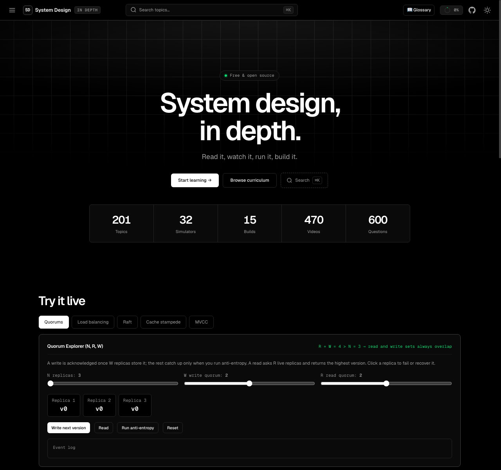

# Data Structures & Algorithms In Depth

<p align="center">
  <strong>An open-source interactive platform for mastering Data Structures & Algorithms from mathematical first principles, CPU hardware reality, and production standard library internals.</strong>
</p>

<p align="center">
  <a href="https://dsa-in-depth.vedgupta.in"></a>
  <a href="https://github.com/innovatorved/dsa-in-depth/actions/workflows/ci.yml"></a>
  <a href="LICENSE#mit-license"></a>
  <a href="LICENSE#creative-commons-attribution-noncommercial-sharealike-40-international"></a>
</p>

<p align="center">
  
  
  
  
  
</p>

<p align="center">
  <a href="https://dsa-in-depth.vedgupta.in"><strong>🚀 Explore the Interactive Platform</strong></a>
</p>

<p align="center">
  <a href="https://dsa-in-depth.vedgupta.in">
    
  </a>
</p>

---

## Why This Exists

Most DSA resources fail engineers in one of two ways: pattern-memorization mills that teach brittle recipes without hardware reality, or dense academic textbooks without visual intuition or runnable code. **DSA In Depth** bridges both worlds — grounding every data structure and algorithm in canonical primary literature (CLRS, Sedgewick & Wayne, Knuth TAOCP, Tarjan, Okasaki), 64-byte L1 cache line mechanics, interactive state-machine simulators, and production engine case studies (V8 `TimSort`, Rust `hashbrown` SwissTables, Linux Kernel `rbtree`, Redis `ZSET` skiplists, `ripgrep` SIMD Aho-Corasick, `git diff` Myers).

- **Zero frameworks, zero build step** — Pure HTML/CSS/JavaScript running statically on any browser or server.
- **Hands-on exploration** — Every abstract theorem is accompanied by a runnable visual simulator or algorithmic build.
- **Deep academic & industry grounding** — 180 architecture diagrams, 180 curated YouTube videos, concrete failure mode breakdowns, and primary literature citations.
- **100% Free & Open Source** — No signup, no paywall, no ads.

---

> **Note:** This project and its embedded browser IDE (`@innovatorved/code-lab`) are in active development.

## Curriculum Overview (6 Tracks, 18 Modules, 180 Units)

The curriculum is structured into **6 core algorithmic tracks** following strict conceptual prerequisites:

| Track | Scope & Core Concepts | Units | Key Topics |
|---|---|:---:|---|
| **1. Foundations, Memory Hierarchy & Linear Structures** | RAM model vs CPU cache hierarchy, asymptotic rigor ($O/\Omega/\Theta$), Master & Akra-Bazzi theorems, potential-function ($\Phi$) amortized analysis, contiguous arrays, bitwise SWAR parallelism, linked lists, skip lists, and monotonic stacks/deques. | 30 | Cache-oblivious layouts, branchless bit manipulation, V8 Elements Kinds, Redis ZSET |
| **2. Hashing, Sorting & Divide-and-Conquer** | Universal & $k$-independent hashing, Robin Hood & Cuckoo probing, SipHash HashDoS defense, Bloom/Cuckoo/Xor filters, Count-Min Sketch, HyperLogLog, Quicksort 3-way partitioning, TimSort, BFPRT selection, parametric binary search, and FFT. | 30 | Abseil/Rust SwissTables, TimSort galloping invariants, Eytzinger layout, Cooley-Tukey FFT |
| **3. Trees, Balanced Hierarchies & Range Queries** | Binary tree traversals, Morris threading, BST Hibbard degradation, $d$-ary & Fibonacci heaps, AVL & Sedgewick LLRB trees, Treaps, Splay trees, $B^+$ vs LSM trees, persistent path copying, Fenwick trees, Lazy Segment Trees, LCA, and HLD. | 30 | Linux CFS intrusive `rbtree`, timer wheels vs heaps, Segment Tree Beats, Mo's algorithm |
| **4. Strings, Automata & Information Retrieval** | Prefix & PATRICIA radix tries, bitwise XOR tries, Rabin-Karp rolling hashes, KMP prefix automaton, Z-algorithm, Boyer-Moore, Aho-Corasick multi-pattern scanner, Manacher's algorithm, Suffix Trees/Arrays/Automata, BWT/FM-Index, Thompson NFA regex, Myers diff, and Huffman/LZ77. | 20 | `ripgrep` SIMD Teddy + Aho-Corasick, ReDoS defense via Thompson NFA, `git diff` Myers/Histogram |
| **5. Graph Theory, Shortest Paths & Network Flow** | CSR cache-friendly graphs, 0-1 BFS, DFS edge classification, Kahn & DFS topological sort, Tarjan bridges/articulation points/SCCs, 2-SAT, DSU $\alpha(N)$ inverse Ackermann, Kruskal/Prim/Borůvka MST, Dijkstra, $A^*$, Bellman-Ford, Johnson APSP, Dinic Max-Flow, and Hopcroft-Karp/Hungarian matching. | 30 | Build system cycle diagnostics, Contraction Hierarchies road routing, Max-Flow Min-Cut reductions |
| **6. Dynamic Programming, Combinatorial Search & Advanced Paradigms** | Combinatorial generation, backtracking pruning, Knuth Algorithm X (Dancing Links), Alpha-Beta minimax, greedy exchange & matroid proofs, SRTBOT DP framework, Knapsack/LIS/LCS/Interval/Tree/DAG DP, Bitmask/SOS/Digit/Broken-Profile DP, D&C/Knuth/Convex Hull Trick (Li Chao)/Aliens WQS optimizations, computational geometry, Miller-Rabin, and NP reductions. | 40 | Modern CDCL SAT solvers, Knuth-Plass $\TeX$ line breaking, Li Chao trees, Bentley-Ottmann sweep line |

---

## Interactive Simulators & From-Scratch Builds

### 32 Interactive Visual Simulators
Interactive sandboxes let you step forward/backward, inspect structural invariants, and compare hardware metrics:
- **Linear & Memory Hierarchy:** Cache Line Traversal (`sim-cache-line-traversal`), Dynamic Array Amortized Potential (`sim-dynamic-array-amortized`), Two-Pointers Dutch Flag (`sim-two-pointers-dutch-flag`), Sliding Window Monotonic Deque (`sim-sliding-window-monotonic-deque`), Monotonic Stack Histogram (`sim-monotonic-stack-histogram`), Skip List Express Lanes (`sim-skip-list-lanes`).
- **Hashing & Probabilistic Sketches:** Open Addressing vs Robin Hood (`sim-open-addressing-robin-hood`), SwissTable 16-Way SIMD Probe (`sim-swisstable-simd`), Bloom & Cuckoo Filter (`sim-bloom-cuckoo-filter`), Consistent Hashing Ring (`sim-consistent-hashing-ring`).
- **Trees & Range Queries:** Floyd Bottom-Up Heap Build (`sim-heap-floyd-build`), AVL & LLRB Rotations (`sim-avl-llrb-rotations`), Treap Split & Merge (`sim-treap-split-merge`), Splay Tree Zig-Zig (`sim-splay-tree-zig-zig`), $B^+$ Tree Page Split (`sim-bplus-tree-page-split`), Fenwick Tree Bit Geometry (`sim-fenwick-bit-geometry`), Lazy Segment Tree (`sim-segment-tree-lazy`).
- **Strings & Automata:** KMP & Z-Box Automaton (`sim-kmp-z-automaton`), Aho-Corasick Failure Links (`sim-aho-corasick-trie`), Suffix Array & Kasai LCP (`sim-suffix-array-lcp`), Thompson NFA vs Backtracking Race (`sim-thompson-nfa-vs-backtrack`).
- **Graphs, Shortest Paths & Flow:** Tarjan SCC & Bridges (`sim-dfs-tarjan-scc`), DSU Path Compression (`sim-dsu-path-compression`), Dijkstra & $A^*$ Frontier Grid (`sim-dijkstra-astar-grid`), Bellman-Ford Negative Cycle (`sim-bellman-ford-negative-cycle`), Kruskal & Prim MST (`sim-kruskal-prim-mst`), Dinic Blocking Flow (`sim-dinic-max-flow`).
- **Dynamic Programming & Geometry:** Knapsack DP Table (`sim-knapsack-dp-table`), Myers Diff & Edit Distance (`sim-edit-distance-myers-diff`), Bitmask TSP Lattice (`sim-bitmask-tsp`), Convex Hull Trick & Li Chao (`sim-convex-hull-trick-lichao`), Graham/Andrew Convex Hull (`sim-graham-andrew-convex-hull`).

### 22 Interactive DSA Build Labs (`/build/<slug>/`)
Each reference implementation runs in the browser at `/build/<slug>/` using **`@innovatorved/code-lab`** ([GitHub](https://github.com/innovatorved/code-lab) · [Docs Wiki](https://github.com/innovatorved/code-lab/wiki) · [npm](https://www.npmjs.com/package/@innovatorved/code-lab)):

1. [`/build/build-dynamic-circular-deque/`](build/build-dynamic-circular-deque/) — Dynamic Circular Ring Buffer & Amortized $O(1)$ Vector
2. [`/build/build-lfu-lru-cache/`](build/build-lfu-lru-cache/) — $O(1)$ LRU & Frequency-Bucketed LFU Cache Engine
3. [`/build/build-robin-hood-hash-map/`](build/build-robin-hood-hash-map/) — Open-Addressed Robin Hood Hash Map with Backward-Shift Deletion
4. [`/build/build-bloom-cuckoo-filter/`](build/build-bloom-cuckoo-filter/) — Kirsch-Mitzenmacher Bloom Filter & Counting/Cuckoo Filter
5. [`/build/build-hybrid-introsort-timsort/`](build/build-hybrid-introsort-timsort/) — Adaptive TimSort (Run Detection, Binary Insertion, Galloping Merge)
6. [`/build/build-indexed-d-ary-priority-queue/`](build/build-indexed-d-ary-priority-queue/) — Indexed 4-Ary Min/Max Priority Queue with $O(\log_4 N)$ `decreaseKey`
7. [`/build/build-llrb-order-statistic-tree/`](build/build-llrb-order-statistic-tree/) — Sedgewick Left-Leaning Red-Black Order-Statistic Tree (`rank` & `select`)
8. [`/build/build-implicit-treap-rope/`](build/build-implicit-treap-rope/) — Implicit Treap Rope with Lazy Range Reversal & Split/Merge
9. [`/build/build-fenwick-range-tree/`](build/build-fenwick-range-tree/) — Dual Fenwick Tree for $O(\log N)$ Range Add, Range Sum & Binary Lifting
10. [`/build/build-lazy-segment-tree/`](build/build-lazy-segment-tree/) — Generic Monoid Segment Tree with Range Affine Lazy Propagation
11. [`/build/build-persistent-segment-tree/`](build/build-persistent-segment-tree/) — Path-Copying Persistent Segment Tree for Subarray $K$-th Smallest
12. [`/build/build-aho-corasick-scanner/`](build/build-aho-corasick-scanner/) — Multi-Pattern Aho-Corasick Automaton with Failure & Output Links
13. [`/build/build-suffix-array-lcp/`](build/build-suffix-array-lcp/) — $O(N \log N)$ Prefix-Doubling Suffix Array, Kasai LCP & RMQ Search
14. [`/build/build-thompson-nfa-regex-engine/`](build/build-thompson-nfa-regex-engine/) — ReDoS-Proof Thompson NFA Regular Expression Engine
15. [`/build/build-tarjan-scc-2sat-solver/`](build/build-tarjan-scc-2sat-solver/) — Tarjan's Single-Pass SCC Condensation & Linear-Time 2-SAT Solver
16. [`/build/build-dsu-rollback-connectivity/`](build/build-dsu-rollback-connectivity/) — Disjoint Set Union with Rollback Log & Dynamic Connectivity
17. [`/build/build-astar-bidirectional-router/`](build/build-astar-bidirectional-router/) — $A^*$ and Bidirectional Dijkstra Pathfinding Router
18. [`/build/build-dinic-max-flow-engine/`](build/build-dinic-max-flow-engine/) — Dinic's Maximum Flow, Min-Cut Partitioning & Bipartite Matching Engine
19. [`/build/build-dancing-links-exact-cover/`](build/build-dancing-links-exact-cover/) — Knuth's Algorithm X with Dancing Links (DLX) Exact Cover Solver
20. [`/build/build-hirschberg-linear-space-diff/`](build/build-hirschberg-linear-space-diff/) — Hirschberg's $O(\min(N,M))$-Space Sequence Alignment & Diff Engine
21. [`/build/build-li-chao-convex-hull-dp/`](build/build-li-chao-convex-hull-dp/) — Dynamic Li Chao Segment Tree & Convex Hull Trick DP Optimizer
22. [`/build/build-kd-tree-nearest-neighbor/`](build/build-kd-tree-nearest-neighbor/) — 2D/3D $k$-d Tree with Bounding-Box Pruning for $K$-Nearest Neighbor Search

---

## Running Locally

```bash
# Serve the static application locally
npm run serve

# Run full build (asset stamping, static page generation, and validation)
npm run build

# Run strict schema, primary-source, simulator, and unit test validation
npm run validate
```
